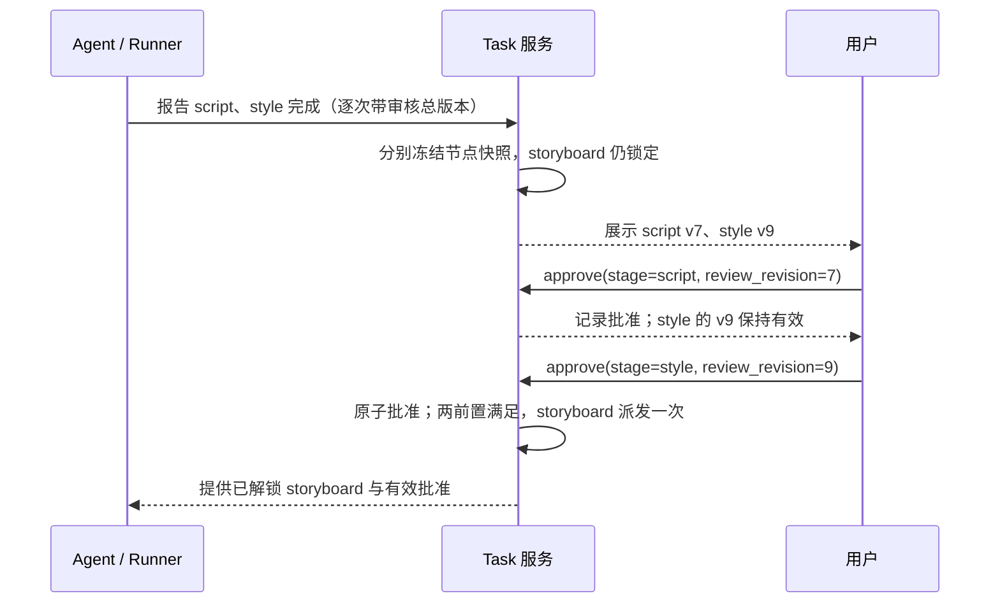

# 任务审核接口

Goal 的 `review_plan` 保存审核约定，Task 的 `review.plan` 执行同一份约定。
Preview 是待审产物，不是执行步骤；节点不引用 Preview Agent。

## Review Plan

输入为标准 JSON 节点列表；数组顺序只决定展示顺序，`after` 决定依赖。

```json
[
  {"id":"script","previews":["script"]},
  {"id":"style","after":[],"previews":["keyframes"]},
  {"id":"storyboard","after":["script","style"],"previews":["storyboard"]}
]
```

- **`id`**：任务内唯一、非空且稳定的节点标识。
- **`after?`**：直接前置节点的 ID；省略为 `[]`。全部前置获得有效批准才解锁。
- **`previews?`**：所属 Studio 的 Preview 标识；省略为 `[]`，可跨节点复用。界面按语言显示 Studio 的名称和说明。无 Preview 时审核正文，显示系统文案。
- **`null`**：安排未定，只允许规划；`[]` 表示无需额外审核，执行已授权工作。

前后端、CLI 与 Runner 共用 Zod Schema 和 Kahn 拓扑校验纯函数，开放代码不导入 Cloud 或 Web。
先校验字段类型与非空值，再拒绝重复 ID、重复依赖、未知引用、自依赖、循环和未知 Preview。
引用可指向数组后面的节点。校验输出规范化列表（补齐两个空数组）和拓扑层级；层级由依赖计算，不另存一份计划。
节点写入只接受上述字段。既有计划或冻结快照可能仍含历史标题，界面使用 Studio 元数据。
失败不部分保存、不派发工作；HTTP 返回 `400 bad_request`，CLI 非零退出，MCP 返回 `isError:true`。

## 读取任务

`GET /v1/tasks/{id}` 返回原 Task 元数据，审核字段改为以下结构。
移除单一 `review.phase/status/kind/snapshot` 和每 Agent 审核进度。

```http
GET /v1/tasks/W-818
```

```json
{
  "review": {
    "revision": 8,
    "plan": [
      {"id":"script","after":[],"previews":["script"]},
      {"id":"style","after":[],"previews":["keyframes"]},
      {"id":"storyboard","after":["script","style"],"previews":["storyboard"]}
    ],
    "pending_plan": null,
    "stages": [
      {"id":"script","status":"ready","revision":7,"snapshot":{
        "kind":"stage",
        "stageId":"script",
        "body":"已同步的脚本正文",
        "plan":[
          {"id":"script","after":[],"previews":["script"]},
          {"id":"style","after":[],"previews":["keyframes"]},
          {"id":"storyboard","after":["script","style"],"previews":["storyboard"]}
        ],
        "previews":[{"id":"script","assets":[]}]
      }},
      {"id":"style","status":"running","revision":8,"snapshot":null},
      {"id":"storyboard","status":"blocked","revision":1,"snapshot":null}
    ]
  }
}
```

- **`review.revision`**：任务审核状态的总版本，供计划和状态写入做并发校验。
- **`stages`**：与有效计划 ID 一一对应；`blocked` 等前置批准，`available` 可开始，`running` 制作中，`ready` 待审核，`approved` 已批准。
- **节点 `revision`**：该节点最后变化时的审核总版本；无关节点变化不更新它。
- **`snapshot`**：`ready/approved` 的冻结证据，其余为 `null`。服务端保存所审计划、`body` 正文和 Preview 资产版本；`previews:[]` 时仍保存正文。
- **`pending_plan`**：无候选时为 `null`；候选为 `{revision, snapshot:{kind:"plan", plan:[...]}}`。确认前 `review.plan` 仍是原安排。

多个节点可同时 `running` 或 `ready`，没有单一“当前阶段”。
例中风格节点的版本 8 不使脚本待审版本 7 过期。
无权访问等读取错误沿用既有响应；读取不派发工作。

## 提出安排或报告节点

`POST /v1/tasks/{id}/review` 接收以下互斥操作。
`review_revision` 必须是读取时的 **`review.revision`**；成功返回最新 Task。

```json
{"operation":"plan","review_revision":8,"review_plan":[{"id":"script","previews":["script"]}]}
```

`plan` 校验候选安排并冻结到 `pending_plan`，不替换有效计划。
安排未定时的首次提案也需确认；待确认期间暂停新节点派发。
批准计划只接受约定，不批准其中的产物。
批准后按新依赖重算解锁状态；定义改变或删除的节点及其下游失去有效批准，按新旧依赖的并集确定影响范围。
仅调整展示顺序不使产物批准失效；未受影响节点保留状态、版本和批准。

```json
{"operation":"status","review_revision":8,"stage":"style","status":"done"}
```

`status` 接受 `running|done`，`stage` 必填，只允许更新依赖已满足的节点。
`done` 要求相关正文及资产已同步，生成该节点的冻结快照；有下游时置为 `ready`，末尾节点直接完成（`approved`），无需额外批准。
版本匹配时，重复报告同一状态与同一内容返回原结果，不增加修订。
再次编辑待审正文或资产会使该节点版本过期，须同步并重新报告 `done`。

```json
{"operation":"revise","review_revision":10,"stage":"script"}
```

`revise` 修改指定节点，使其与所有传递下游的快照批准失效，撤销这些节点的旧派发授权。
指定节点在前置批准仍有效时变为 `available`，下游重算为 `blocked/available`；无关分支不变。
修改已批准节点必须经过同一失效处理，不能通过直接内容同步保留旧批准。
同一 Preview 在其他节点产生新版本，不覆盖已有冻结证据。

错误见下表。失败不改变计划、节点或执行队列。

## 批准或要求修改

`POST /v1/tasks/{id}/decisions` 接收 `decision: approve|request_changes`。
产物决定传 `stage` 和 **`stages[].revision`**；计划决定不传 `stage`，使用 **`pending_plan.revision`**。
有候选计划时，省略 `stage` 且版本匹配候选即选择该计划。
无候选计划时，仅有一个 `ready` 节点才可省略 `stage`；否则返回 `409 conflict`。

```http
POST /v1/tasks/W-818/decisions
Idempotency-Key: approve-script-7
Content-Type: application/json

{"decision":"approve","stage":"script","review_revision":7}
```

普通决定成功返回 `201 Decision`。相同幂等请求返回原决定；同一目标版本重复批准不重复派发。
目标正文、资产、定义或前置批准变化时拒绝旧版本；无关分支的状态变化不阻止批准。
`request_changes` 计划时撤回候选、保留有效安排；作用于节点时按 `revise` 的影响范围重审，保留历史决定。

每次批准原子记录证据并重算所有节点，首次解锁的节点只获一次执行授权。
复用现有 Task 作业队列，一次接续可携带多个可做节点；任务忙碌时合并待执行节点，
不要求每节点创建 Session。领取和执行前重验授权，计划或批准失效时撤销旧授权。
示例中的分镜必须等脚本与风格全部批准；仅批准脚本不派发分镜。
所有非末尾节点均获有效批准、末尾节点完成后才进入 Studio 的后续交付，仍须完成既有检查与任务完成记录。

`after_reply`、`card_version` 沿用延后批准机制，绑定同一个节点或候选计划及其版本。
首次接受返回 `202`；仅回复成功、同步完成且目标仍有效时落决定。
不能自动改批回复中新出现的计划或产物。停止、失败、相关版本变化或权限撤销会取消请求。

Question 继续使用独立问答入口；回答不批准节点，批准不关闭问题。
派发还须满足相关 Question、任务生命周期与执行归属要求。
恢复从保存的依赖与有效批准重算允许工作，不递增游标、不跳过待审，也不重复派发。

## 错误

| 响应 | 本次契约新增的拒绝场景 |
| --- | --- |
| `400 bad_request` | 非法 JSON/节点字段、重复 ID 或依赖、未知节点或引用、自依赖、循环、未知 Preview、互斥操作混用。 |
| `409 review_outdated` | 写入总版本过期，或决定目标的内容、定义、依赖批准已变化。重新读取；不得自动改用新版本批准。 |
| `409 conflict` | 节点未解锁、待审目标不唯一、资产未同步、试图绕过审核或旧执行仍写入。 |

既有访问权限、取消与停止检查保留。任何拒绝都不记录批准或启动后续工作。

## CLI

```sh
akb task review W-818
akb task review W-818 --file revised-review.json --revision 8
akb task review W-818 --stage style --status done --revision 9
akb task review W-818 --revise-from script --revision 10
akb task approve W-818 --stage script --revision 7
```

- **读取**：不带写参数返回已约定计划、每个节点的状态与版本、候选计划；不再返回单一当前阶段。
- **报告**：`--file`、`--status`、`--revise-from` 互斥，`--revision` 对应审核总版本；输出最新审核状态。
- **批准**：`--revision` 对应所审节点或候选计划版本；`--stage` 的省略规则与 HTTP 相同。输出既有决定结果。
- **失败**：参数或文件错误非零退出且不写入；服务端错误保留原错误码。批准不得自动读取新版本代填。

旧的 Preview Agent 阶段参数与 `confirm_preview` 分支移除，不保留双轨执行。
既有任务一次性迁移成果、节点及批准证据后使用同一契约，不从旧阶段序号继续推进。
可证明版本对应关系的批准保留有效；不能证明的仅保留历史并停止相关执行，等待重审。

## MCP 草稿读取

`wildcrane_draft_read({discussionId?, path?})` 沿用讨论定位和权限规则。
返回 Goal 的 `review_plan`，以及所属 Studio 的可用 Preview 标识目录。
保存使用 [目标接口](goal-previews.md) 的同一契约；读取不开始任务。

```js
wildcrane_draft_read({discussionId:"dsc_example"})
```

定位、登录和访问错误沿用既有响应；缺少 Preview 目录时不能把原安排降级为空。



## Deployment and rollback

- **Compatibility**: deploy CLI contract 19 and Runner protocol 25 with the Worker and Web. Drain older Runner sessions before reopening task writes; the Worker refuses their registration.
- **Cutover**: back up the database, apply migration 0234 once, then resume stopped tasks after reviewing their migrated plan. Unprovable legacy approvals remain historical and cannot unlock work.
- **Evidence**: `cloud.review_plan_cutover` retains original Goal, Task and active job rows; revision history stays immutable. Only service operators can access the backup table.
- **Rollback**: pause writes, restore the pre-cutover database backup and matching previous application versions together. Do not restore old approval rows into the new runtime. `test:sql` verifies a full backup/restore and original approval history in an isolated database.
