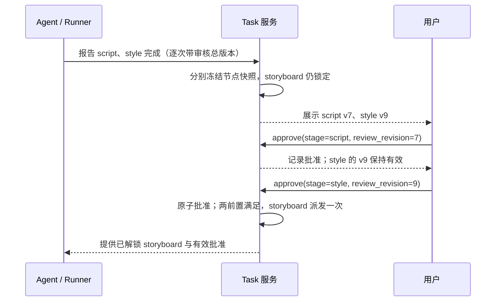

# 任务审核接口

Goal 的 `review_plan` 保存审核约定，Task 的 `review.plan` 执行同一份约定。
Preview 是供审阅的草稿或成果。任务背景和要求留在卡片正文。

## Review Plan

输入为标准 JSON 节点列表；数组顺序只决定展示顺序，`after` 决定依赖。

```json
[
  {"id":"script","previews":["script"]},
  {"id":"style","after":[],"previews":["keyframes"]},
  {"id":"storyboard","after":["script","style"],"previews":["storyboard"]}
]
```

- **`id`**：任务内唯一、非空且稳定的节点标识。
- **`after?`**：直接前置节点的 ID，省略为 `[]`。待生成的 Preview 等待直接前置成果获批。普通工作和自动交付衔接沿用现有的完成规则。
- **`kind?`**：`"work"` 表示普通工作节点，可省略 `previews`。
- **`previews?`**：所属 Studio 或已显式定义的自定义 Preview ID，可跨节点复用。新保存的审核节点至少引用一个 Preview。带前置节点的终端 `delivery-handoff`（名称冲突时为 `delivery-handoff:flow`）也可使用空列表。
- **`null`**：安排未定，只允许规划；`[]` 表示无需额外审核，执行已授权工作。

前后端、CLI 与 Runner 共用 Zod Schema 和 Kahn 拓扑校验纯函数，开放代码不导入 Cloud 或 Web。
先校验字段类型与非空值，再拒绝重复 ID、重复依赖、未知引用、自依赖、循环和未知 Preview。
引用可指向数组后面的节点。校验输出规范化列表（补齐两个空数组）和拓扑层级；层级由依赖计算，不另存一份计划。
节点写入只接受上述字段。既有计划和冻结快照仍可读取。审核图仅显示有效 Preview 的依赖，旧计划仍可使用服务端返回的批准操作。
失败不部分保存、不派发工作；HTTP 返回 `400 bad_request`，CLI 非零退出，MCP 返回 `isError:true`。

## 读取任务

`GET /v1/tasks/{id}` 返回原 Task 元数据，审核字段改为以下结构。
移除单一 `review.phase/status/kind/snapshot` 和每 Agent 审核进度。

```http
GET /v1/tasks/W-818
```

```json
{
  "review": {
    "revision": 8,
    "plan": [
      {"id":"script","after":[],"previews":["script"]},
      {"id":"style","after":[],"previews":["keyframes"]},
      {"id":"storyboard","after":["script","style"],"previews":["storyboard"]}
    ],
    "previews": {"keyframes":"not_generated","storyboard":"waiting"},
    "approvals": [{"stage":"script","revision":7,"starts":[]}],
    "stages": [
      {"id":"script","status":"ready","revision":7,"snapshot":{
        "kind":"stage",
        "stageId":"script",
        "body":"已同步的脚本正文",
        "plan":[
          {"id":"script","after":[],"previews":["script"]},
          {"id":"style","after":[],"previews":["keyframes"]},
          {"id":"storyboard","after":["script","style"],"previews":["storyboard"]}
        ],
        "previews":[{"id":"script","assets":[]}]
      }},
      {"id":"style","status":"running","revision":8,"snapshot":null},
      {"id":"storyboard","status":"blocked","revision":1,"snapshot":null}
    ]
  }
}
```

- **`preview_definitions`** 为任务当前的自定义定义。 `GET /v1/tasks/{id}/studio` 的 `previews` 包含绑定 Studio 和有效定义。分享页在既有可见范围内返回显示名称和图标。
- **`review.revision`**：任务审核状态的总版本，供计划和状态写入做并发校验。
- **`stages`**：与有效计划 ID 一一对应；`blocked` 等前置批准，`available` 可开始，`running` 制作中，`ready` 待批准，`approved` 已批准，`done` 已完成。
- **节点 `revision`**：该节点最后变化时的审核总版本；无关节点变化不更新它。
- **`snapshot`**：已提交成果的冻结证据，未冻结时为 `null`。服务端保存所审计划、`body` 正文和 Preview 资产版本；`previews:[]` 时仍保存正文。

- **`review.previews`**：仅列出尚不可读取的 Preview，值为 `not_generated` 或 `waiting`。任务详情的 `preview_inputs` 提供已同步正文和资产引用，执行前也可读取。
- **`approvals`**：当前可批准的冻结阶段及其版本。一次批准可立即派发一个下游节点时，`starts` 给出其 Preview ID。网页和 CLI 使用同一结果。

多个节点可同时 `running` 或 `ready`，没有单一“当前阶段”。
例中风格节点的版本 8 不使脚本待审版本 7 过期。
无权访问等读取错误沿用既有响应；读取不派发工作。

## 设置安排或报告节点

`POST /v1/tasks/{id}/review` 接收以下互斥操作。
`review_revision` 必须是读取时的 **`review.revision`**；成功返回最新 Task。

```json
{"operation":"plan","review_revision":8,"review_plan":[{"id":"script","previews":["script"]}]}
```

`plan` 校验并立即启用新安排，返回更新后的 `review.plan`。
服务按新安排推进已解锁工作。需要人审的成果仍须单独批准。请求可提供 `review_flow` 或 `review_plan`，也可提供完整的 `preview_definitions`。安排和定义一起生效。省略的字段沿用有效值。
文本流程使用 Preview 显示名称，JSON 计划使用 ID。用 `review_flow: ""` 或 `review_plan: []` 表示无需额外审核。无效节点或引用返回 `400 bad_request`，提示可用名称、ID 和修正方法，已存安排、定义和执行状态保留。

```json
{"operation":"plan","review_revision":8,"review_flow":"UI design -> Accessibility report","preview_definitions":[{"id":"accessibility-report","title":{"en":"Accessibility report","zh":"无障碍检查报告"},"instructions":"Check keyboard navigation and visible focus."}]}
```

节点快照冻结引用的完整定义。制作要求和组件约束变化使相关节点及下游重审，纯标题变更保留现有批准。
`PUT /v1/tasks/{id}/card` 按有效目录校验新增和修改的 Preview。已经移除的 Preview 可保留原正文和资产引用。
新计划生效时按新依赖重算解锁状态；定义改变或删除的节点及其下游失去有效批准，按新旧依赖的并集确定影响范围。
仅调整展示顺序不使产物批准失效；未受影响节点保留状态、版本和批准。

```json
{"operation":"status","review_revision":8,"stage":"style","status":"done"}
```

`status` 接受 `running|done`，`stage` 必填，只允许更新依赖已满足的节点。
`done` 要求相关正文及资产已同步，并生成该节点的冻结快照。独立审阅项和解锁下游审阅的上游阶段进入 `ready`。已有审阅上游的末端成果直接完成（`done`）。普通工作依赖可以在前置节点进入 `ready` 时继续。
版本匹配时，重复报告同一状态与同一内容返回原结果，不增加修订。
再次编辑待审正文或资产会使该节点版本过期，须同步并重新报告 `done`。

```json
{"operation":"revise","review_revision":10,"stage":"script"}
```

`revise` 修改指定节点，使其与所有传递下游的快照批准失效，撤销这些节点的旧派发授权。
指定节点在前置批准仍有效时变为 `available`，下游重算为 `blocked/available`；无关分支不变。
修改已批准节点必须经过同一失效处理，不能通过直接内容同步保留旧批准。
同一 Preview 在其他节点产生新版本，不覆盖已有冻结证据。

错误见下表。失败不改变计划、节点或执行队列。

## 执行已就绪的任务

任务返回 `can_execute: true` 时，用户可直接执行该任务。`POST /v1/tasks/{id}/execute` 仍使用 `review.revision`，并按已保存的安排派发工作。直接执行不会记录审阅决定。

`POST /v1/tasks/{id}/execute` 使用任务的 **`review.revision`**，并派发当前可执行的工作。有待批准的上游阶段时，此次只批准这些上游阶段。否则一次接受就绪的独立审阅项。已有审阅上游的末端成果在提交后自动完成。

```http
POST /v1/tasks/W-918/execute
Idempotency-Key: execute-918-2
Content-Type: application/json

{"review_revision":2}
```

成功返回 `200 Task`。过期版本返回 `409 review_outdated`。任务尚未准备好、存在待答问题或对话仍在回复时返回 `409`，这些情况不会部分接受产物或派发工作。可使用相同的幂等键重试。

## 批准或要求修改

`POST /v1/tasks/{id}/decisions` 接收 `decision: approve|request_changes`。
产物决定传 `stage` 和 **`stages[].revision`**。仅有一项可批准时可省略 `stage`，否则返回 `409 conflict`。

```http
POST /v1/tasks/W-818/decisions
Idempotency-Key: approve-script-7
Content-Type: application/json

{"decision":"approve","stage":"script","review_revision":7}
```

普通决定成功返回 `201 Decision`。相同幂等请求返回原决定；同一目标版本重复批准不重复派发。
目标正文、资产、定义或前置批准变化时拒绝旧版本；无关分支的状态变化不阻止批准。
`request_changes` 按 `revise` 的影响范围重审，保留历史决定。

每次批准原子记录证据并重算所有节点，首次解锁的节点只获一次执行授权。
复用现有 Task 作业队列，一次接续可携带多个可做节点；任务忙碌时合并待执行节点，
不要求每节点创建 Session。领取和执行前重验授权，计划或批准失效时撤销旧授权。
示例中的分镜必须等脚本与风格全部批准；仅批准脚本不派发分镜。
所有节点完成且需要人审的前置节点均获有效批准后，Studio 继续交付并记录既有检查结果。

`after_reply`、`card_version` 沿用延后批准机制，绑定同一个节点及其版本。
首次接受返回 `202`；仅回复成功、同步完成且目标仍有效时落决定。
新提交的成果须以其版本重新批准。停止、失败、相关版本变化或权限撤销会取消请求。

Question 继续使用独立问答入口；回答不批准节点，批准不关闭问题。
派发还须满足相关 Question、任务生命周期与执行归属要求。
恢复从保存的依赖与有效批准重算允许工作，不递增游标、不跳过待审，也不重复派发。

## 错误

| 响应 | 本次契约新增的拒绝场景 |
| --- | --- |
| `400 bad_request` | 非法 JSON/节点字段、重复 ID 或依赖、未知节点或引用、自依赖、循环、未知 Preview、互斥操作混用。 |
| `409 review_outdated` | 写入总版本过期，或决定目标的内容、定义、依赖批准已变化。重新读取；不得自动改用新版本批准。 |
| `409 conflict` | 节点未解锁、待审目标不唯一、资产未同步、试图绕过审核或旧执行仍写入。 |

既有访问权限、取消与停止检查保留。任何拒绝都不记录批准或启动后续工作。

## CLI

```sh
akb task review W-818
akb task review W-818 --review 'UI design + API docs -> Prompts' --revision 8
akb task review W-818 --preview-definitions-file revised-previews.json --revision 8
akb task review W-818 --stage style --status done --revision 9
akb task review W-818 --revise-from script --revision 10
akb task approve W-818 --stage script --revision 7
```

- **读取**：不带写参数返回生效安排、尚不可读取的 Preview、冻结版本和当前可用批准。
- **报告**：`--review`、`--file`、`--status`、`--revise-from` 互斥，`--revision` 对应审核总版本。`--preview-definitions-file` 可单独提交或与计划输入合用。计划输入见[目标与任务审阅 CLI](goal-previews.md#cli)。
- **批准**：`--revision` 对应所审节点的版本。`--stage` 的省略规则与 HTTP 相同。输出既有决定结果。
- **失败**：参数或文件错误非零退出且不写入；服务端错误保留原错误码。批准不得自动读取新版本代填。

旧的 Preview Agent 阶段参数与 `confirm_preview` 分支移除，不保留双轨执行。
既有任务一次性迁移成果、节点及批准证据后使用同一契约，不从旧阶段序号继续推进。
可证明版本对应关系的批准保留有效；不能证明的仅保留历史并停止相关执行，等待重审。

## MCP 草稿读取

`wildcrane_draft_read({discussionId?, path?})` 沿用讨论定位和权限规则。
返回 Goal 的 `review_plan`，`preview_definitions` 和所属 Studio 的 Preview 名称目录。
保存使用 [目标接口](goal-previews.md) 的同一契约；读取不开始任务。

```js
wildcrane_draft_read({discussionId:"dsc_example"})
```

定位、登录和访问错误沿用既有响应；缺少 Preview 目录时不能把原安排降级为空。



## Deployment and rollback

- **Task-specific Previews (0254)**: Apply the additive migration and coordinate AKB contract 27 and Runner protocol 29 with Cloud and Web. Existing rows have empty definitions. Before rolling back an environment with custom definitions, pause writes and back up definitions and review snapshots.

- **Compatibility**: deploy CLI contract 19 and Runner protocol 25 with the Worker and Web. Drain older Runner sessions before reopening task writes; the Worker refuses their registration.
- **Cutover**: back up the database, apply migration 0234 once, then resume stopped tasks after reviewing their migrated plan. Unprovable legacy approvals remain historical and cannot unlock work.
- **Review plan update (0248)**: saved arrangements on active tasks take effect and unlock eligible work. Stopped tasks stay stopped. Unaffected approvals keep their evidence.
- **Review plan confirmation removal (0271)**: Stored submissions take effect using the normal stage revision rules. Existing run authorization and task status govern dispatch. The migration records no stage decisions.
- **Legacy review cleanup (0252)**: Tasks still carrying the synthetic Review and Delivery plan from cutover use the normal execution flow. Historical revisions and explicitly saved plans remain readable. Task detail returns synced Preview sections and their pinned assets together in `preview_inputs`.
- **Evidence**: `cloud.review_plan_cutover` retains original Goal, Task and active job rows; revision history stays immutable. Only service operators can access the backup table.
- **Rollback**: pause writes, restore the pre-cutover database backup and matching previous application versions together. Do not restore old approval rows into the new runtime. `test:sql` verifies a full backup/restore and original approval history in an isolated database.
