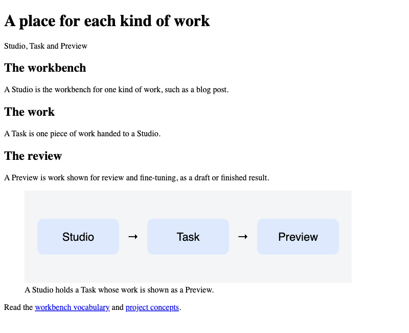

Turn a topic and source material into a blog post. Use this Studio when you want to review the structure before drafting or revise a post you already have.

## Getting started

1. Start a task with Blog post. Share the topic, audience, language, and intended destination.
2. Attach the sources and illustrations you want to use. Ask what you want to review before writing.

## Write a product explainer

```text
Write a blog post for people new to WildCrane explaining Studio, Task, and Preview. Use the attached primer and diagram. Show me the outline first, then deliver the article in Markdown and HTML.
```



> Provide sources for claims and say whether the Studio should reuse your images or create new ones.
