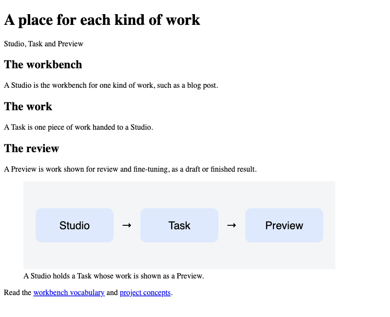

把选题和资料写成博客文章。可以先确认结构再写正文，也可以修改现有文章。

## 如何开始

1. 新建一个任务并选用博客文章，说明选题、读者、语言和发布渠道。
2. 附上参考资料和想使用的配图，说明哪些内容需要先确认。

## 写一篇产品概念说明

```text
给刚接触 WildCrane 的读者写一篇文章，解释工作台、任务和 Preview。使用我附上的术语说明和配图。先给我看大纲，再交付 Markdown 和 HTML 正文。
```



> 给出产品数据或引用的出处，并说明是沿用现有配图还是制作新图。
