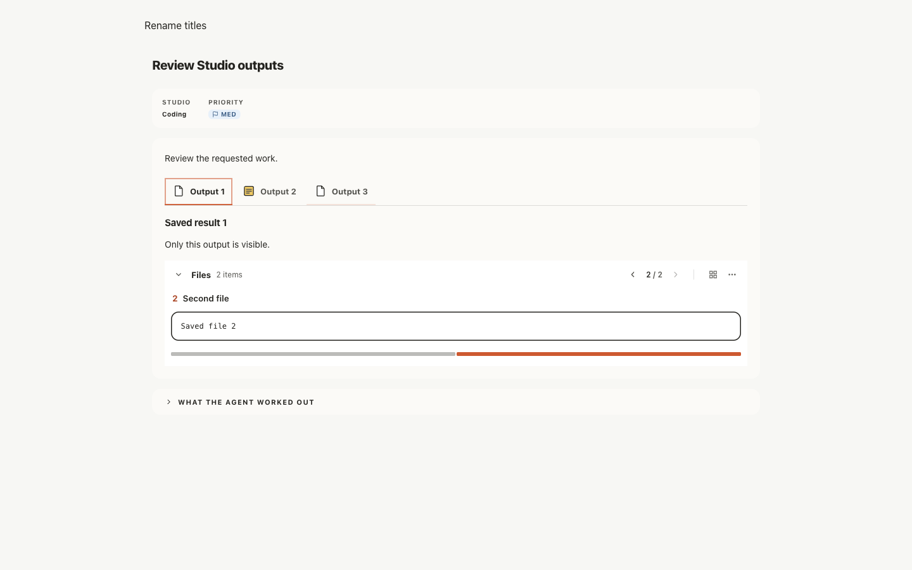

Plan and deliver repository changes, from a focused bug fix to a new interface or a documentation update.

## Getting started

1. Open the project that contains the code and start a task with Coding.
2. Describe what should happen, what happens today, and how you will check the result. Attach screenshots or a short reproduction when available.

## Fix a task output display

```text
On the task's output page, show only the result for the currently selected tab. Today two results can appear together. Check the behavior on desktop and mobile and preserve access to the other results through their tabs.
```



> Name any files or behavior the change must preserve. Ask to see the UI or API design first if it needs approval.
