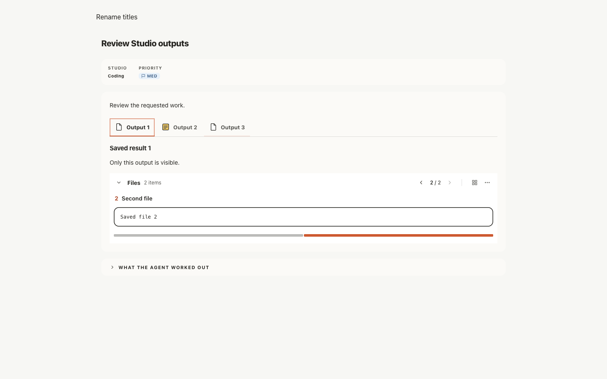

规划并交付项目改动，适用于修复问题、添加界面或更新文档。

## 如何开始

1. 打开代码所在的项目，新建一个任务并选用软件开发。
2. 说明当前表现、预期效果和验收方式。有截图或复现步骤时一起提供。

## 修复任务成果的显示

```text
任务成果页只显示当前标签对应的成果。现在有时会同时出现两份成果。请验证桌面和手机端，其他成果仍能通过各自的标签查看。
```



> 指出需要保留的文件或行为。如果需要先看界面或接口设计，在请求中说明。
