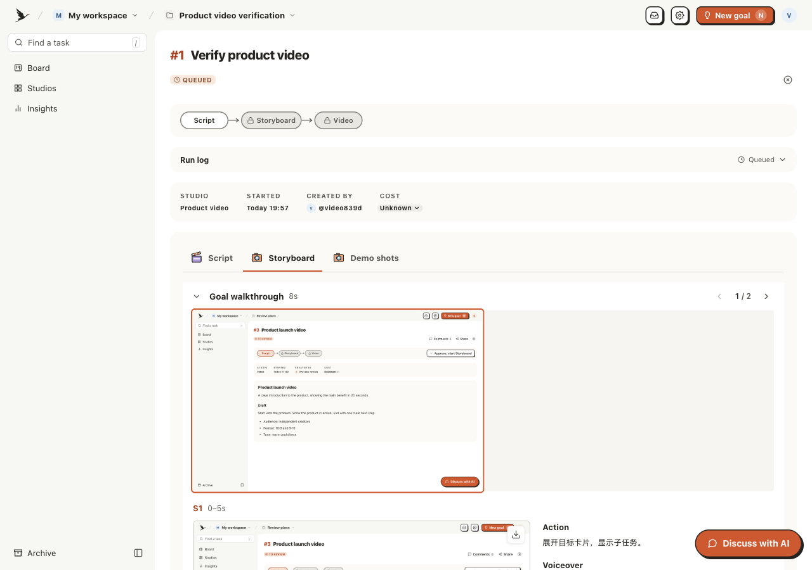

Make a product demo or launch video from product facts, interface footage, and brand assets.

## Getting started

1. Start a task with Product video and attach a product link or footage, approved copy, and brand materials.
2. Set the audience, length, aspect ratio, and publishing channel. Ask for the script or storyboard first if you want to review it.

## Make a short product walkthrough

```text
Make a 20-second product video for people new to WildCrane. Show how a discussion becomes a task with reviewable outputs. Use the supplied product footage, start with a script and storyboard, and render 16:9 after approval.
```



> Point out product claims and on-screen wording that must match the source exactly.
