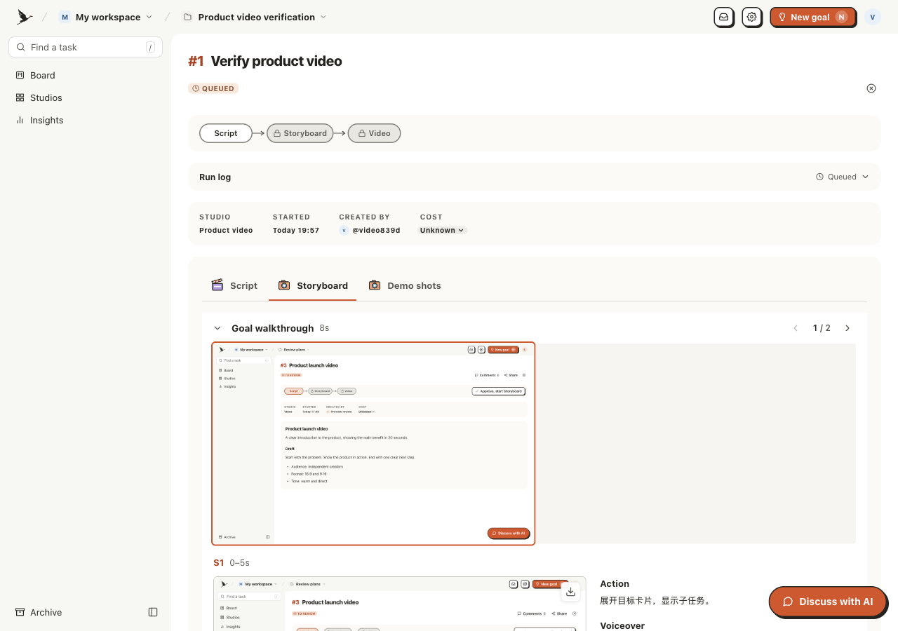

用产品信息、界面录屏和品牌素材制作产品演示或发布视频。

## 如何开始

1. 新建一个任务并选用产品视频，提供产品链接或录屏、确认过的文案及品牌素材。
2. 说明受众、时长、画幅和发布渠道，需要先确认脚本或分镜时写进请求。

## 制作一条产品操作演示

```text
给第一次接触 WildCrane 的人制作一条 20 秒视频，演示如何把讨论变成带可审核成果的任务。使用我提供的录屏，先给脚本和分镜，确认后输出 16:9 成片。
```



> 标明必须与来源一致的产品说法和屏幕文案。
