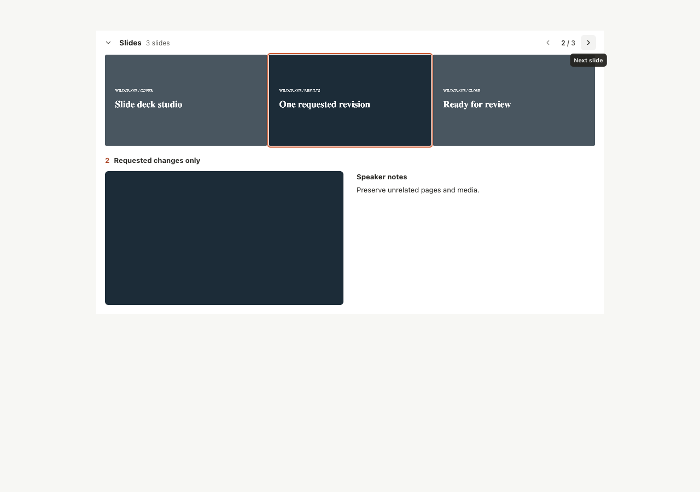

Create a slide deck from an outline or revise individual slides in an existing deck.

## Getting started

1. Start a task with Slide deck. Attach your outline or deck and any brand assets.
2. Say who will see it, how long you have to present, and whether you need wireframes, finished slides, or a PowerPoint export.

## Review and revise a team update

```text
Make a three-slide team update using the attached notes. Put the context, results, and next steps on separate slides. Include short speaker notes. Show the slides first so I can revise the results slide before export.
```



> For a revision, identify the slide or its title. Request PowerPoint explicitly if you need the export.
