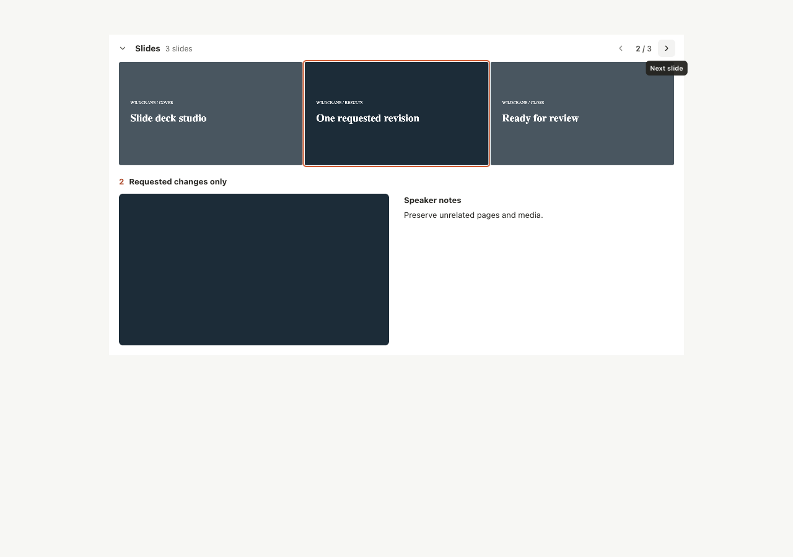

把提纲制作成演示文稿，或只修改现有演示文稿中的指定页面。

## 如何开始

1. 新建一个任务并选用演示文稿，附上提纲或现有幻灯片及品牌素材。
2. 说明听众、演讲时长，以及需要线框稿、完成的幻灯片还是 PowerPoint 导出。

## 制作和修改团队进度简报

```text
根据附件做一份三页的团队简报，分别讲背景、结果和下一步，每页附简短演讲备注。先给我看幻灯片，我确认第二页结果后再导出。
```



> 修改时指出页码或标题。需要 PowerPoint 时在请求中明确提出。
