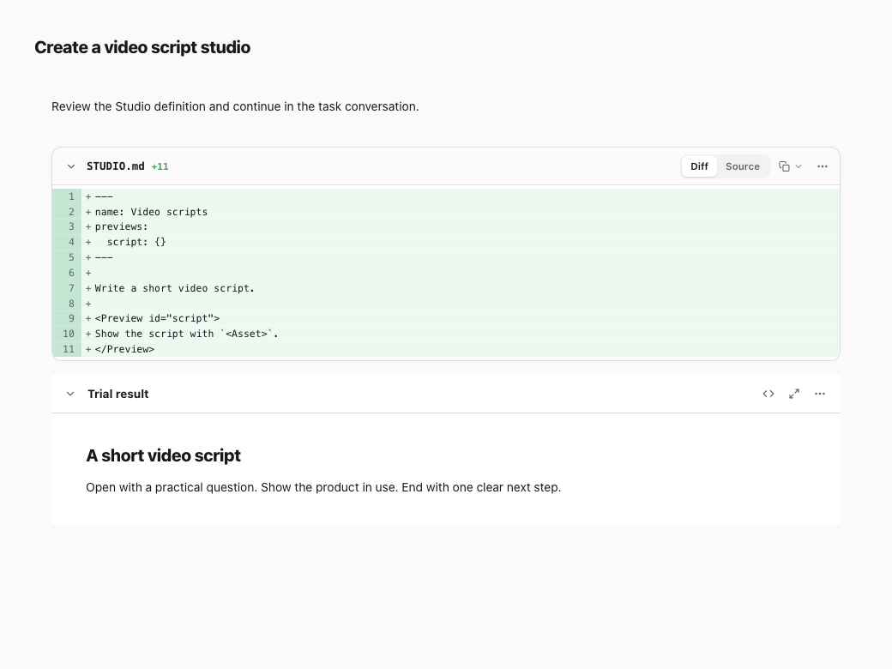

Turn a recurring workflow into a reusable Studio, or revise the definition of a Studio your workspace already owns.

## Getting started

1. Start a task with Studio builder. Describe the recurring work, typical inputs, and what a good result looks like.
2. Provide a sample request and identify any drafts that should be reviewed before work proceeds.

## Create a workflow for short video scripts

```text
Create a Studio for short product video scripts. It should take a product brief and a target audience, then propose a hook, a demo beat, and a closing line. Give me one script to trial and a draft Studio definition to review.
```



> Use a representative task for the trial. To revise a Studio, name it and describe the specific behavior to change.
