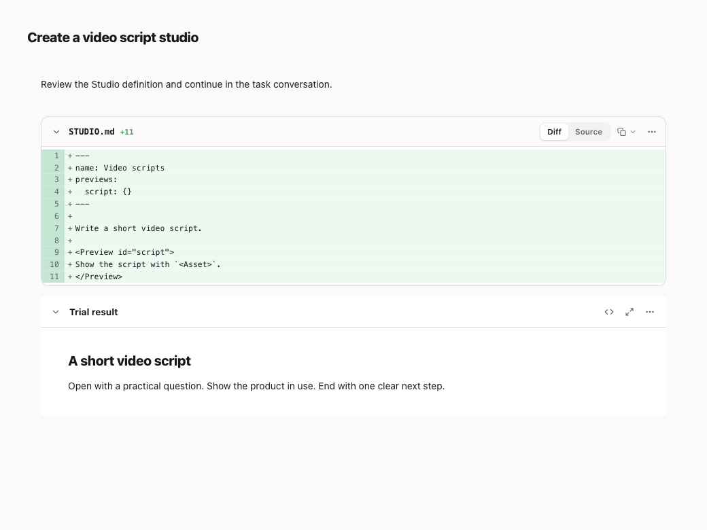

把重复工作做成可复用的工作台，也可以修改工作区里已有的工作台。

## 如何开始

1. 新建一个任务并选用搭建工作台，说明要重复做的工作、典型输入和想要的结果。
2. 给出一个真实的示例请求，标明哪些草稿需要先审核。

## 创建短视频脚本工作台

```text
搭建一个写产品短视频脚本的工作台。根据产品简介和目标受众写开场、演示段和结束语。先给一个脚本试用结果和工作台定义草稿，供我审核。
```



> 用一个有代表性的任务试用。修改已有工作台时，写明名称和要调整的行为。
