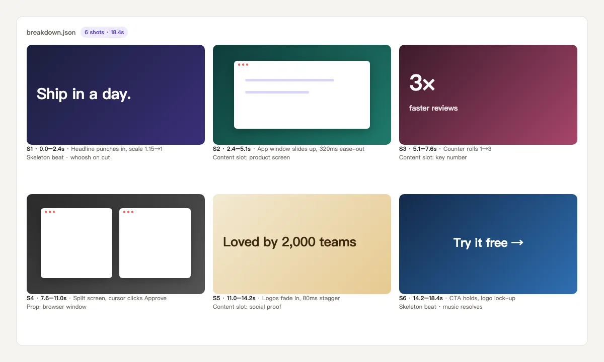
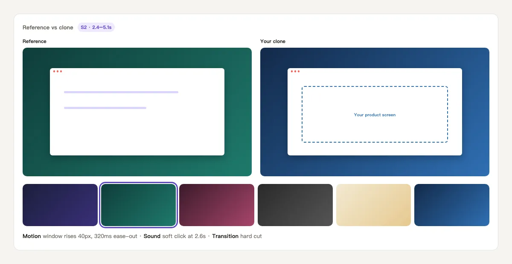
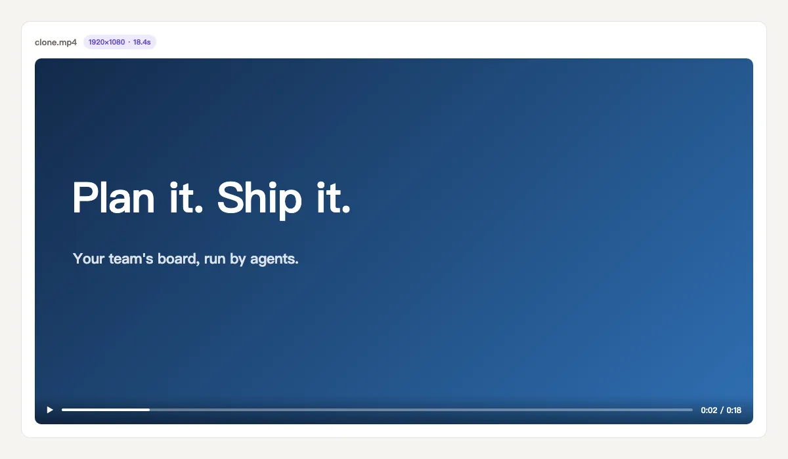

Use a reference video's shot order, pacing, and layout to make a video with your own material.

## Getting started

1. Start a task with Video clone and attach the reference video.
2. Approve the storyboard, then supply your footage, copy, and brand assets.

## Break down a reference video

```text
Break down my 15-second video. List each shot's timing, framing, on-screen text, and transitions. Give me a storyboard to review first.
```



## Replace the assets and make the video

```text
Use the approved storyboard with my product screenshots and headline. Compare the shots to check the pacing, then render a vertical video.
```





> Use reference video, images, and audio you have permission to use.
