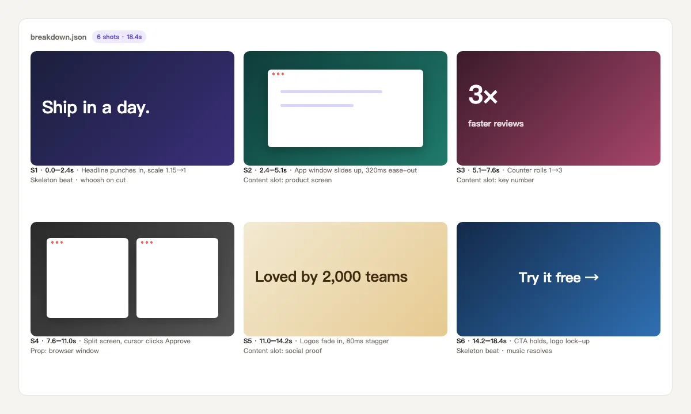
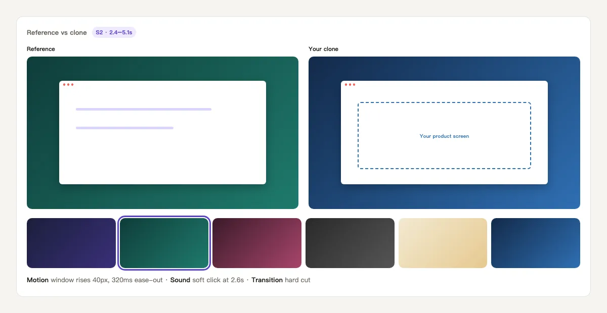
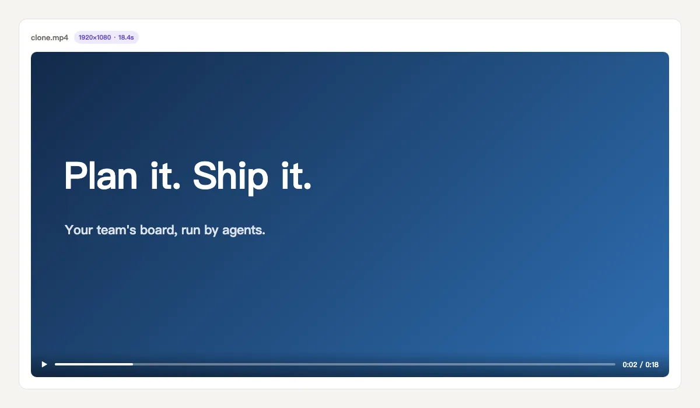

从参考视频提炼镜头顺序、节奏和画面结构，用自己的素材制作成片。

## 如何开始

1. 新建一个任务并选用视频克隆，附上参考视频。
2. 先确认分镜，再换上你的素材、文案和品牌元素。

## 拆解参考视频

```text
拆解我上传的 15 秒视频，列出每个镜头的起止时间、构图、屏幕文案和切换节奏。先给我可审核的分镜。
```



## 换素材并制作成片

```text
沿用已确认的分镜，换上我上传的产品截图和标题。用逐镜对比确认节奏，再输出竖屏成片。
```





> 使用你有权使用的参考视频、图片和音频。
